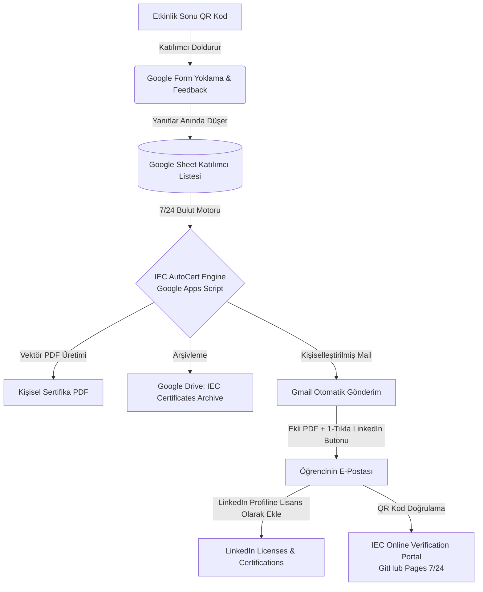

# IUS Engineering Club — Otomatik Sertifika Dağıtım Sistemi (AutoCert Blueprint)

Bu belge, **IUS Engineering Club**'ın düzenlediği tüm atölye, seminer, hackathon ve zirvelerde katılımcılara **%100 otomatik, kişiselleştirilmiş ve doğrulanabilir e-posta sertifikası** dağıtmak için kurulan tam teşekküllü sistem mimarisini ve 5 dakikalık kurulum rehberini içerir.

---

## 1. Sistemin Mimarisi & Çalışma Mantığı (System Flow)



---

## 2. Sistemin 5 Temel Bileşeni

| Bileşen | Dosya / Bağlantı | Görevi |
| :--- | :--- | :--- |
| **1. 7/24 Bulut Gönderim Motoru** | [`scripts/IEC_AutoCert_Engine.js`](file:///c:/Users/Kaan/.gemini/antigravity-ide/scratch/ius-engineering-events/scripts/IEC_AutoCert_Engine.js) | Google Sheet'e eklenen, tek tıkla toplu veya form dolduruldukça otomatik sertifika basıp mail atan Apps Script. |
| **2. Prestijli Sertifika Tasarımı (HTML/A4)** | [`export_documents/IEC_Official_Certificate_Sample.html`](file:///c:/Users/Kaan/.gemini/antigravity-ide/scratch/ius-engineering-events/export_documents/IEC_Official_Certificate_Sample.html) | A4 yatay formatta, altın varak & gece mavisi çerçeveli, mühürlü, çift imzalı resmi şablon. |
| **3. Online Doğrulama Portalı** | [`verify/index.html`](file:///c:/Users/Kaan/.gemini/antigravity-ide/scratch/ius-engineering-events/verify/index.html) | `hasankaan28.github.io/ius-engineering-events-site/verify/` adresinde çalışan, QR kod okutulunca açılan doğrulama sayfası. |
| **4. Yerel Python Üretim Motoru** | [`scripts/generate_certificates.py`](file:///c:/Users/Kaan/.gemini/antigravity-ide/scratch/ius-engineering-events/scripts/generate_certificates.py) | Bilgisayardan tek tıkla yüksek çözünürlüklü PDF basan ve masaüstüne kaydeden CLI aracı. |
| **5. Masaüstü Sertifika Havuzu** | `C:\Users\Kaan\Desktop\IEC\06_Etkinlikler_ve_Workshoplar\Sertifikalar` | Üretilen tüm resmi PDF'lerin depolandığı resmi klasör. |

---

## 3. 5 Dakikada Canlıya Alma Rehberi (Google Sheets Kurulumu)

Kulüp yönetiminin (Kaan, Mahmut, Bekir veya Efe) her etkinlik için yapacağı tek şey şudur:

### Adım 1: Google Form & Sheet Oluşturma
1. Google Drive'da yeni bir **Google Form** açın (örneğin: *"Modern AI Workshop Katılım & Yoklama Formu"*).
2. Formda şu 3 zorunlu soruyu sorun:
   - **Full Name (Tam Ad Soyad)** — Sertifikaya basılacak resmi isim.
   - **Email Address (E-posta Adresi)** — Sertifikanın gönderileceği e-posta.
   - **Department / Faculty (Bölüm)** — İsteğe bağlı (Örn: CS, SE, EE).
3. Formun yanıtlarını bir **Google Sheet** tablosuna bağlayın.

### Adım 2: Kodu Google Sheet'e Yapıştırma
1. Google Sheet tablosunu açın.
2. Üst menüden **Extensions (Uzantılar)** ➔ **Apps Script** seçeneğine tıklayın.
3. Açılan kod editöründeki her şeyi silin ve [`scripts/IEC_AutoCert_Engine.js`](file:///c:/Users/Kaan/.gemini/antigravity-ide/scratch/ius-engineering-events/scripts/IEC_AutoCert_Engine.js) dosyasındaki kodun tamamını kopyalayıp yapıştırın.
4. En üstteki `IEC_CONFIG` bloğunda etkinlik adını ve tarihini güncelleyin:
   ```javascript
   DEFAULT_EVENT_TITLE: "Modern AI & Prompt Engineering Workshop",
   DEFAULT_EVENT_DATE: "October 2026",
   DEFAULT_EVENT_CODE: "AI01"
   ```
5. **Save (Kaydet - Ctrl+S)** butonuna basın ve sayfayı yenileyin.

### Adım 3: Gönderim Menüsünü Kullanma
Sayfayı yenilediğinizde Google Sheet üst menüsüne özel **"🎓 IEC Sertifika Sistemi"** menüsü gelecektir:
- **`🚀 Bekleyen Tüm Sertifikaları Gönder`**: Tablodaki tüm katılımcıların sertifikalarını oluşturur, Drive'a kaydeder ve maillerine ekli PDF olarak fırlatır.
- **`🧪 Test Sertifikası Gönder`**: Kendi mailinize anında bir test sertifikası atarak sistemi test eder.
- **`📊 Günlük Kalan E-posta Kotasını Göster`**: Kalan günlük e-posta kotanızı gösterir.

---

## 4. İki Farklı Çalışma Modu

### Mod A: Yönetim Onaylı Toplu Dağıtım (Tavsiye Edilen)
- **Nasıl Çalışır**: Etkinlik biter, yoklama formu kapanır.
- Yönetim kurulu tablodaki isimleri 1 dakika gözden geçirir (sahte/trol isimleri veya katılmayanları siler).
- Üst menüden **"🚀 Bekleyen Tüm Sertifikaları Gönder"** butonuna basar.
- 100 kişinin sertifikası 2 dakika içinde maillerine düşer.
- Zaten gönderilen kişilerin yanına `SENT` ve `Tarih/Saat` damgası vurulur; mükerrer gönderim imkansızdır.

### Mod B: %100 Otomatik Anında Gönderim (Auto-Pilot)
- **Nasıl Çalışır**: Öğrenci konferans salonunda QR kodu okutup formu gönderdiği an saniyeler içinde mailine sertifika düşer.
- **Kurulum**: Apps Script editöründe sol taraftaki **Triggers (Tetikleyiciler - Saat Simgesi)** ➔ **Add Trigger** ➔ Fonksiyon: `onFormSubmit` ➔ Event: `On form submit` seçilir.

---

## 5. Katılımcıya Giden E-Postanın İçeriği

Katılımcının mailine gelen profesyonel e-posta şu unsurları barındırır:
1. **Kulüp ve FENS Başlığı**: Resmi IUS Lacivert & Altın Varak kurumsal kimlik.
2. **Kişiselleştirilmiş Tebrik**: *"Dear [Ad Soyad], On behalf of IUS Engineering Club and FENS, congratulations..."*
3. **Ekli Yüksek Çözünürlüklü PDF**: Resmi mühürlü, Prof. Dr. Leila Miller ve Hasan Kaan ıslak imzalı vektör PDF.
4. **🚀 1-Tıkla LinkedIn Profiline Ekleme Butonu**:
   - Butona basıldığında öğrencinin LinkedIn sayfası açılır ve Sertifika Adı, Kurum (IUS Engineering Club), Tarih ve Doğrulama URL'si **otomatik doldurulmuş** olarak gelir.
5. **Doğrulama Bağlantısı**: QR kod veya link ile sitemizdeki online portaldan teyit imkanı.

---

## 6. Yerel Python Aracıyla Çevrimdışı / Toplu Üretim

İnternet veya Google Drive olmadan da yerel bilgisayarınızda anında PDF üretmek isterseniz:
```powershell
# 1. Örnek Sertifika Üretme
python scripts/generate_certificates.py --sample

# 2. Özel Bir Katılımcı İçin Üretme
python scripts/generate_certificates.py --name "Nazlıcan Cebeci" --event "Marshmallow Challenge" --cert-id "IEC-2026-MC01-0012"

# 3. CSV Dosyasından Toplu Üretme
python scripts/generate_certificates.py --csv katilimcilar.csv
```
Üretilen tüm PDF'ler otomatik olarak masaüstündeki resmi klasöre kopyalanır:
`C:\Users\Kaan\Desktop\IEC\06_Etkinlikler_ve_Workshoplar\Sertifikalar\`

---

## 7. E-Posta Kotası ve Önemli İpuçları
- **IUS Kurumsal Hesabı (`@ius.edu.ba`)**: Günlük **1.500 adet** e-posta hakkı sağlar.
- **Kişisel Gmail Hesabı (`@gmail.com`)**: Günlük **100 adet** e-posta hakkı sağlar.
- Kulüp etkinliklerinde genellikle 50-150 arası katılımcı olduğu için kota fazlasıyla yeterlidir.
- Büyük hackathonlarda (DevHack vb.) IUS kurumsal maili veya Google Workspace hesabı kullanılması önerilir.
